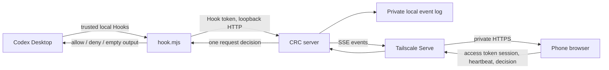

# Architecture

## Components

- `server.js`: authenticated sessions, append-only event IDs, SSE replay and active permission waiters.
- `hook.mjs`: consumes official Hook JSON from stdin; sends only to loopback; emits the corresponding Hook decision on stdout. Empty output continues native desktop approval.
- `desktop-catalog.mjs`: separate, read-only app-server connection using initialize and thread/list. It does not start or resume tasks and does not infer live desktop execution state.
- `mobile-presence.mjs`: mobile session + SSE connection + recent heartbeat required for online state; reconnect owners prevent an old stream from clearing a new one.
- `public/progress.mjs`: normalizes successful update_plan events and reduces activity per turn; percentages come from explicit completed steps.
- `permission-scope.mjs`: conservative recognition of a literal read-only directory-listing command for display only.
- `scripts/`: initialization, Hook merge/uninstall, launcher and local diagnostics.

## Authorization lifecycle

1. A trusted Hook creates an approval/question associated with a conversation, turn and tool call.
2. The callback establishes a renewable waiter before enabling buttons.
3. Before creating a request, an offline mobile status returns control to native Codex approval or questions. An existing CRC request losing its mobile heartbeat is parked, retaining the same ID and callback for reconnection.
4. Mobile reconnection resumes pending requests. A local CRC browser can also decide.
5. Manual decisions resolve once. Expiry, lost callbacks and terminal tasks invalidate stale submissions.
6. Explicit native handoff ends the Hook and cannot be reclaimed by mobile.

Question answers are validated, returned to the corresponding Hook as model-visible feedback and never appended to CRC event storage. Each conversation keeps separate IDs and drafts.

TaskHealth reads bounded local Codex records/SQLite data for the current turn. It distinguishes failures, retries, activity and unconfirmed state; it cannot guarantee compatibility with future record formats. AccountBalance caches safe read-only data for 60 seconds, and ProviderBalance only sends existing credentials to the verified configured provider origin.

## Data and transport

Conversation metadata and Hook events may contain private information. They stay in local runtime files and within the configured Tailnet transport. CRC does not implement encryption at rest or full transcript capture. Network access control, HTTPS and system account protection are part of deployment.

## Testing boundaries

Integration tests execute the real Hook script against an isolated server with generated secrets and temporary storage. Tool calls in authorization fixtures are not executed. Directory RPC tests use a simulated app-server process and do not guarantee every desktop version's compatibility. Hook installer tests operate only on temporary synthetic Codex configurations.
